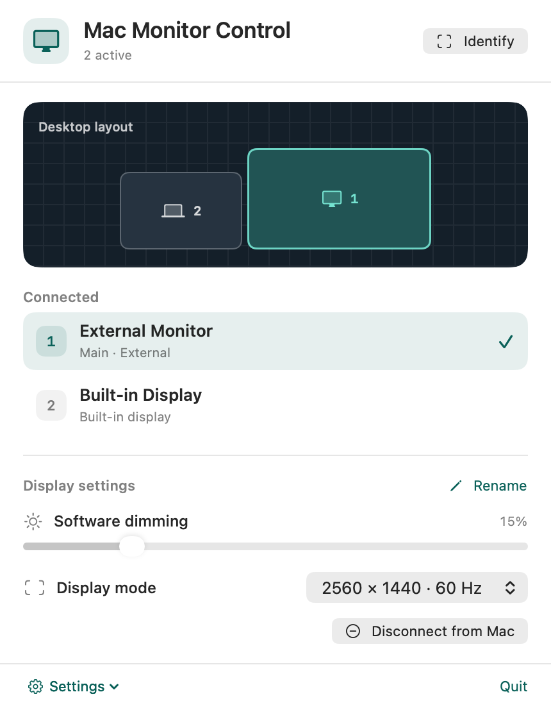
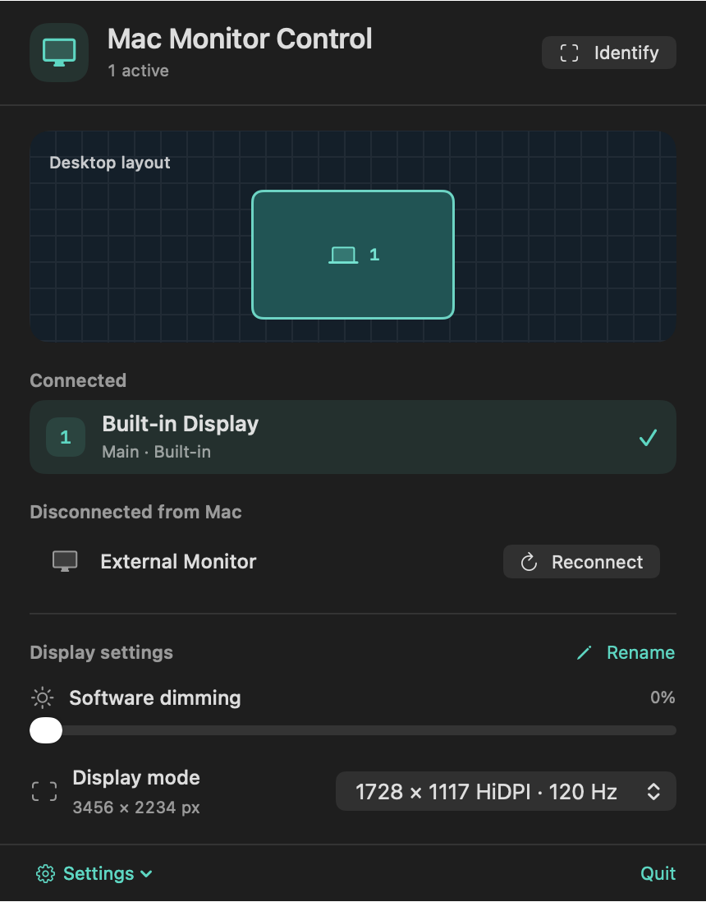

# MacMonitorControl

MacMonitorControl is a native macOS menu bar app for managing built-in and external displays. Use it to disconnect a shared HDMI monitor from your Mac desktop while you use its other input, then reconnect it without unplugging the cable.

## Screenshots

| Connected displays · Light mode | Reconnect a display · Dark mode |
| --- | --- |
|  |  |

## Features

- Identify and rename displays and select them from a live desktop layout.
- Change available resolutions, scaling and refresh rates, arrange displays, set the main display, and mirror screens.
- Adjust software dimming per display or use optional global dimming shortcuts.
- Disconnect and reconnect an external display while another desktop display is active. Switch inputs using the monitor’s controls.

Display mode and layout changes revert after 15 seconds unless you choose **Keep**. If you lose the picture during a preview, wait for the timer. Disconnect uses an undocumented macOS API and can vary by OS version, monitor, and connection. The Mac App Store requires public APIs. [Apple App Review Guidelines](https://developer.apple.com/app-store/review/guidelines/#software-requirements)

## Requirements

- macOS 14 or later is the deployment target.
- Xcode 27.2 was used for the verified build. The project builds for Apple silicon and Intel.
- Runtime testing used an Apple silicon Mac on macOS 27.2.1. Disconnect and reconnect were also verified on a shared HDMI display. Intel runtime and older macOS versions still need testing.

## Build and run

MacMonitorControl is distributed as source. Build the app locally in Xcode.

1. Open `MacMonitorControl.xcodeproj` in Xcode.
2. Select the **MacMonitorControl** scheme and run it.
3. Click the display icon in the macOS menu bar.

To build and test from the project directory:

```sh
xcodebuild -project MacMonitorControl.xcodeproj -scheme MacMonitorControl -destination 'platform=macOS' build
xcodebuild -project MacMonitorControl.xcodeproj -scheme MacMonitorControl -destination 'platform=macOS' test
```

When building from an exFAT drive, keep Xcode’s derived data on an APFS volume. macOS metadata files written to exFAT can interfere with signing.

## Privacy

Display identifiers, aliases, and app preferences are used locally. The app has no telemetry or network client.

## Contributing

See the [contributor guide](AGENTS.md) for code and hardware testing guidelines.

The [feature research](reports/Mac%20display%20utility%20features.md) describes the project’s early design and product comparisons.

## License

[MIT](LICENSE) © 2026 WorkForFun.
